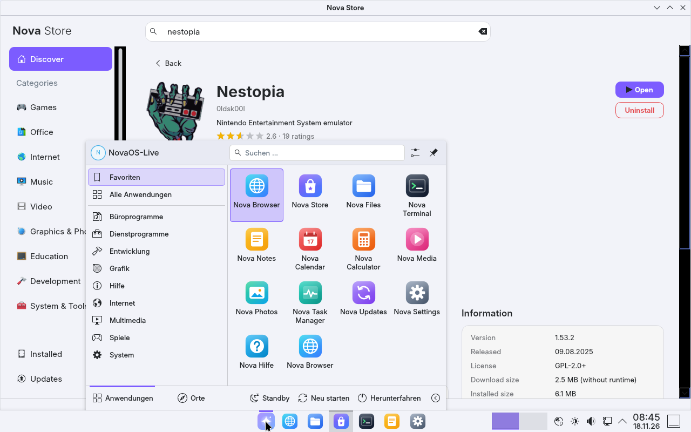

# NovaOS

**NovaOS** ist ein echtes, installierbares Desktop-Betriebssystem auf Basis von
**Debian 13 „trixie“** (stable) mit **Linux 6.12** und **KDE Plasma 6** – mit eigenem
Design, eigenem App Store, eigenen System-Apps und einem grafischen Installer.

> Status: **0.1.0 „Aurora“ – Entwicklerversion.** Das ISO wird aus diesem Repository
> gebaut und wurde in QEMU getestet: Live-Start (BIOS, UEFI, Secure Boot), Desktop,
> Browser mit echten Websites, Nova Store mit echter App-Installation, grafische
> Installation auf eine virtuelle Festplatte, Anmeldung, Persistenz, Neustart und
> Herunterfahren. Was genau getestet wurde, welche Fehler gefunden wurden und was
> **nicht** getestet ist (z. B. echte Hardware), steht in
> [docs/TESTBERICHT.md](docs/TESTBERICHT.md).



## Was ist drin?

| Bereich | NovaOS |
|---|---|
| Basis | Debian 13 „trixie“, Linux 6.12 LTS, systemd, non-free-Firmware für WLAN/GPU/Audio |
| Desktop | KDE Plasma 6.3 mit NovaOS-Design: schwebende Leiste, Startmenü mit Suche, abgerundete Ecken, Transparenz/Unschärfe, Animationen, hell/dunkel, Widgets (Kalender, CPU, RAM, Wetter), virtuelle Desktops, mehrere Monitore |
| **Nova Store** | eigener App Store für **Flathub**: Startseite, Suche, Kategorien, Detailseiten mit Screenshots/Version/Entwickler/Lizenz, Installation mit Fortschritt in %, Berechtigungsprüfung, Bewertungen (ODRS), Installiert/Updates/Deinstallieren, automatische Update-Suche |
| **Nova Browser** | Firefox ESR (Debian-Sicherheitsupdates) mit Datenschutz-Richtlinien: keine Telemetrie, Tracking-Schutz, HTTPS-only |
| Eigene Apps | Nova Updates, Nova Notes, Nova Calendar, Nova Task Manager, Nova Welcome, Nova Help, Über NovaOS |
| Integrierte Apps | Nova Files (Dolphin), Nova Settings (Systemeinstellungen), Nova Terminal (Konsole), Nova Calculator (KCalc), Nova Media (Haruna), Nova Photos (Gwenview) |
| Hardware | NetworkManager (WLAN/Ethernet/VPN), BlueZ, PipeWire, CUPS + IPP-USB, UPower, power-profiles-daemon, udisks2, fwupd |
| Sicherheit | Firewall (ufw) aktiv, automatische Sicherheitsupdates, Flatpak-Sandbox, optionale LUKS-Vollverschlüsselung, Secure-Boot-Kette, persistentes Journal, Timeshift-Snapshots |
| Datenschutz | keine Telemetrie, keine GeoIP-Abfragen, siehe [docs/DATENSCHUTZ.md](docs/DATENSCHUTZ.md) |
| Installation | Live-System + Calamares 3.3 (Sprache, Tastatur, Zeitzone, Partitionierung inkl. Dual-Boot/Verschlüsselung, Benutzer, Fortschritt), BIOS + UEFI |

## Schnellstart

```bash
# ISO bauen (Debian 13 / Ubuntu 24.04 Host, root, ~25 GB frei)
./tools/check-host.sh
sudo make iso                 # Ergebnis: build/out/novaos-0.1.0-amd64.iso

# Tests
make test                     # Unit-Tests und statische Prüfungen
make ui-test                  # alle Nova-Apps offscreen starten (Screenshots)
make qemu                     # ISO in QEMU booten (Screenshots)
```

Ausführlich: [docs/BUILD.md](docs/BUILD.md) · Testen/Installieren: [docs/INSTALLATION.md](docs/INSTALLATION.md)

Das ISO kann auch per GitHub Actions gebaut werden (Workflow *Build NovaOS ISO*, manueller
Start); es wird dann als Artefakt zum Download bereitgestellt.

## Dokumentation

* [Architektur](docs/ARCHITEKTUR.md) – Aufbau, Komponenten, Pakete, Rechtemodell
* [Build-Anleitung](docs/BUILD.md)
* [Testen und Installieren](docs/INSTALLATION.md)
* [Secure Boot](docs/SECURE-BOOT.md) – Funktionsweise und Einschränkungen
* [Datenschutz](docs/DATENSCHUTZ.md)
* [Testbericht](docs/TESTBERICHT.md) – was getestet wurde, was nicht
* [Roadmap](docs/ROADMAP.md)

## Projektstruktur

```
live-build/          Debian-live-build-Konfiguration des ISO
packages/            Quellen der NovaOS-Debian-Pakete (base, desktop, apps, installer)
src/novaos/          Python/Qt6-Quellcode der Nova-Apps
src/data/            .desktop-Dateien, polkit, systemd-Units, Hilfe, APT-Helfer
artwork/             Generator für Logo, Icons, Wallpaper, Boot-Splash, Installer-Folien
tools/               Build-Skripte (build-iso.sh, build-debs.sh, check-host.sh)
tests/               Unit-, UI- und QEMU-Tests
docs/                Dokumentation
```

## Lizenz

Die NovaOS-eigenen Bestandteile (Skripte, Konfiguration, Nova-Apps, Artwork) stehen unter
der **GPL-3.0-or-later** (siehe [LICENSE](LICENSE)). Das ISO enthält Debian, KDE, Firefox und
viele weitere Projekte, die jeweils unter ihren eigenen freien Lizenzen stehen
(`/usr/share/doc/*/copyright`). Die Farbschemata sind von KDE Breeze (LGPL-2.0-or-later)
abgeleitet. „Firefox“ ist eine Marke der Mozilla Foundation; NovaOS liefert den
unveränderten Firefox ESR aus Debian und zeigt ihn nur im Startmenü als „Nova Browser“ an.
